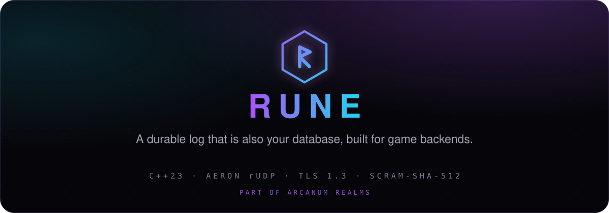
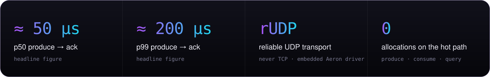
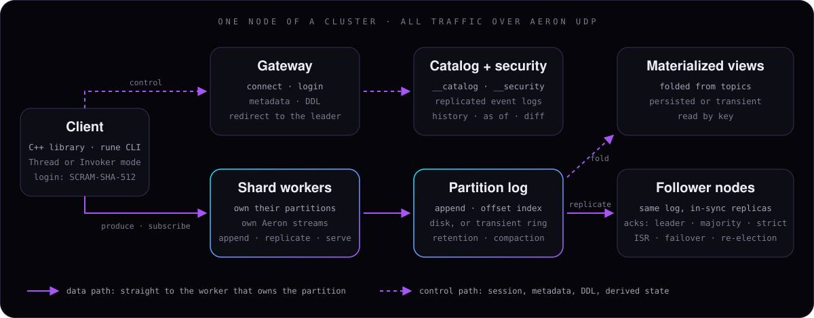

<div align="center">

<a href="https://arcanum.regressorspath.com/rune/">
  
</a>

<br>

[](CMakeLists.txt)
[](conanfile.txt)
[](broker/docs/SECURITY.md)
[](crypto/README.md)
[](broker/docker/Dockerfile)
[](LICENSE)
[](https://github.com/arcanumruna/flight-recorder#readme)

**[Website](https://arcanum.regressorspath.com/rune/)** ·
**[Quick start](#quick-start)** ·
**[Commands](#everyday-commands)** ·
**[Wiki](https://github.com/arcanumruna/rune/wiki)** ·
**[Reference](#documentation)**

</div>

Rune is an ultra-low-latency, replicated, partitioned log that is also a database: typed topics with schema evolution,
materialized views kept current on every write, and point reads by key. It is built for MMORPG backends. The C++ client
runs inside your server tick, the hot path allocates nothing, and every packet travels over reliable UDP (Aeron).

<p align="center">
  
</p>

<sub>Headline figures as published on the [website](https://arcanum.regressorspath.com/rune/); the repository holds the
means to reproduce them ([Benchmarking](https://github.com/arcanumruna/rune/wiki/Benchmarking)), not run output.</sub>

## How it works

<p align="center">
  
</p>

- **Gateway:** connect, login, metadata and DDL. A DDL sent to any broker is redirected to the catalog leader.
- **Shard workers:** each owns its partitions, their logs and views, and its own Aeron streams. Threads talk only through ring buffers.
- **Replicated log:** appended on the leader, replicated to in-sync followers. A topic's `tier` sets what an ack means.
- **Catalog and security logs:** every topic, schema, view, user, role and grant change is one replayable event.
- **Views:** folded from the committed log on the worker that owns the partition, read by key. More: [Design](https://github.com/arcanumruna/rune/wiki/Architecture-and-Design).

## Repository layout

| Directory | What it is |
|---|---|
| [`broker/`](broker) | The broker (`rune_broker`, `rune_role`), its libraries and tests, docker images and e2e launchers, the DR suite, benchmarks |
| [`client-cpp/`](client-cpp) | The C++ client library, the `rune` CLI, examples, client benchmarks |
| [`protocol/`](protocol) | Header-only wire format, record batch v2, error codes |
| [`codec/`](codec) | Typed schemas, record codec, the catalog and security event libraries |
| [`crypto/`](crypto) | TLS 1.3, AEAD and SCRAM over OpenSSL |
| [`ql/`](ql) | The Rune QL parser and plan backends |
| [`docs/`](docs) | Version-coupled reference: configuration, testing, wire protocol, client API |

## Quick start

### Prerequisites

- **Linux** (kernel 5.6+ for io_uring) or **macOS** (built as x86_64; Apple Silicon runs it under Rosetta).
- A C++23 compiler (GCC 13 or Apple clang 17), **CMake 3.31+**, **Ninja**, **Conan 2**, **Python 3** (the source guards run as tests).
- Only for some tasks: a JDK (Conan building Aeron from source), `uuid-dev` and zlib (Linux), Docker with BuildKit (images, e2e).

### Build

- **Linux:** run the steps as written.
- **macOS:** add `-s arch=x86_64 -s compiler.cppstd=23` to step 2 (Conan has no Aeron for Apple Silicon; the x86_64 build runs under Rosetta).

```bash
# 1. Clone Rune and, next to it, the flight recorder and arcanum-metrics (CMake and the docker scripts read the
#    sibling checkouts; without ARCANUM_METRICS_DIR CMake fetches arcanum-metrics at its pinned sha)
git clone https://github.com/arcanumruna/rune.git
git clone https://github.com/arcanumruna/flight-recorder.git
git clone https://github.com/arcanumruna/arcanum-metrics.git
cd rune
# 2. Dependencies: Aeron, spdlog, GTest, Google Benchmark, OpenSSL
conan install . -of build/conan -s build_type=Debug --build=missing
# 3. Configure
cmake -S . -B build -G Ninja -DCMAKE_BUILD_TYPE=Debug \
      -DCMAKE_TOOLCHAIN_FILE=build/conan/conan_toolchain.cmake \
      -DBUILD_TESTING=ON -DBUILD_EXAMPLES=ON -DFLIGHT_RECORDER_DIR=../flight-recorder \
      -DARCANUM_METRICS_DIR=../arcanum-metrics
# 4. A quick slice: build and run the protocol tests (seconds)
cmake --build build --target rune_protocol_tests
ctest --test-dir build/protocol -j8 --output-on-failure
# 5. Everything: build all and run the full suite (thousands of real-UDP tests; a long run)
cmake --build build
ctest --test-dir build -j8 --output-on-failure
```

First-build problems and IDE setup: [Getting Started](https://github.com/arcanumruna/rune/wiki/Getting-Started).

### Run a local broker and send records

A single-node broker in dev mode (`RUNE_AUTH=disabled`: no login, one node only, never in production):
```bash
cmake --build build --target rune_broker rune_role rune rune_produce_subscribe
export RUNE_AUTH=disabled RUNE_NODE_ID=0 RUNE_PEERS=0@127.0.0.1:40111 \
       RUNE_CLIENT_ENDPOINT=127.0.0.1:40200 RUNE_DATA_DIR=/tmp/rune-dev
build/broker/rune_broker storage format --new --ignore-formatted     # once per data directory
build/broker/rune_broker > /tmp/rune-dev.log 2>&1 &
sleep 3 && build/broker/rune_role                                     # ROLE nodeId=0 role=LEADER term=1
build/rune-client/rune ql -e "topic events partitions 1;" --broker 127.0.0.1:40200   # prints topicId=0
RUNE_TARGET='aeron:udp?endpoint=127.0.0.1:40200' RUNE_EGRESS='aeron:udp?endpoint=127.0.0.1:40400' \
RUNE_DATA_DIR=/tmp/rune-dev-client RUNE_CLIENT_TOPIC_TABLE=events:0:1 RUNE_PRODUCE_M=0 \
  build/rune-client/rune_produce_subscribe        # produces 20 records, reads them back, "phase1 OK"
kill %1
```

Authentication is on by default; for a real cluster see [Security Quickstart](https://github.com/arcanumruna/rune/wiki/Security-Quickstart).

## Everyday commands

| Task | Command | Detail |
|---|---|---|
| Build one target | `cmake --build build --target rune_broker` | [Building](https://github.com/arcanumruna/rune/wiki/Building) |
| Run all tests | `ctest --test-dir build -j8 --output-on-failure` | [Testing](https://github.com/arcanumruna/rune/wiki/Testing) |
| Run the regression suite | `ctest --test-dir build -R Regression -j8 --output-on-failure` | [Testing](https://github.com/arcanumruna/rune/wiki/Testing#the-regression-suite) |
| Run the checkpoint gate | `cd broker && scripts/run-regression.sh ../build 10` | [Testing](https://github.com/arcanumruna/rune/wiki/Testing#the-checkpoint-gate) |
| Run one test or a slice | `ctest --test-dir build -R 'GatewayAuth' --output-on-failure` | [Testing](https://github.com/arcanumruna/rune/wiki/Testing#run-one-test) |
| Sanitizer run | `ctest --test-dir build-asan -R Regression -LE latency -j4` (also `build-tsan`) | [Building](https://github.com/arcanumruna/rune/wiki/Building#sanitizer-builds) |
| Docker e2e | `cd broker && bash docker/e2e.sh` | [E2E and DR](https://github.com/arcanumruna/rune/wiki/End-to-End-and-DR-Suites) |
| DR suite | `cd broker/dr-e2e && pytest -v -m "not soak"` | [E2E and DR](https://github.com/arcanumruna/rune/wiki/End-to-End-and-DR-Suites#disaster-recovery-suite) |
| Broker benchmarks | `build-bench/broker/rune_broker_benchmark --benchmark_min_time=0.01s` | [Benchmarking](https://github.com/arcanumruna/rune/wiki/Benchmarking) |

Docker e2e, the DR suite and benchmarks run on a Linux VM: [Running on a Remote VM](https://github.com/arcanumruna/rune/wiki/Running-on-a-Remote-VM).

## Contributing

- One branch per change; never commit to `main` directly.
- Every fix ships a regression test whose name contains `Regression`.
- Run the affected tests on every change and the full `*Regression*` suite (plus ASan/UBSan and TSan) at checkpoints.
- File issues with one type, one `sev:` and at least one `area:` label.
- The full rules, written for humans: [Contributing](https://github.com/arcanumruna/rune/wiki/Contributing).

## Documentation

**[Wiki](https://github.com/arcanumruna/rune/wiki)**: how-to guides for building, testing, e2e and DR suites, the remote
VM, Docker images, benchmarking, security, configuration, the [design](https://github.com/arcanumruna/rune/wiki/Architecture-and-Design)
and [contributing](https://github.com/arcanumruna/rune/wiki/Contributing).

**In the repository** (reference that changes with the code):

| Document | Covers |
|---|---|
| [docs/api/client-cpp.md](docs/api/client-cpp.md) · [wire-protocol.md](docs/api/wire-protocol.md) | The C++ client API; frames, versions, error codes |
| [docs/api/ql.md](docs/api/ql.md) · [codec.md](docs/api/codec.md) · [admin-cli.md](docs/api/admin-cli.md) | Rune QL; schemas and evolution; every `rune` command |
| [docs/configuration.md](docs/configuration.md) · [operations.md](docs/operations.md) | Every setting; deploy, [namespaces](docs/operations.md#namespaces), key rotation, backups, metrics |
| [docs/testing.md](docs/testing.md) · [benchmarks.md](docs/benchmarks.md) · [BENCHMARKING.md](broker/bench/BENCHMARKING.md) · [DR_SUITE.md](broker/dr-e2e/DR_SUITE.md) | Test, benchmark and DR reference |
| [SELF-HOSTING.md](broker/docs/SELF-HOSTING.md) · [SECURITY.md](broker/docs/SECURITY.md) · [CATALOG.md](broker/docs/CATALOG.md) | Long-form operator references |

## License and links

Rune is source-available, not open source. It is licensed under the
[Arcanum Realms Community License](LICENSE), version 1.1. The license is the binding text; this summary is not.

| Free under the license | Needs a commercial license |
|---|---|
| Running Rune in production as the backend of your own games and services, including ones you sell | Offering Rune's log, database or view functionality to others as a hosted or managed service |
| Having a cloud provider, contractor or consultant host, deploy or support it for you | Selling or licensing Rune, or a fork of it, as a product in its own right |
| Modifying it and shipping it inside your game, tools or SDK | A third-party support program marketed as a substitute for ours |
| Evaluation, benchmarks, research and teaching | |

The license includes a patent grant and a 30-day cure period. Contributions are accepted under its section 7.
Third-party components keep their own licenses: see [NOTICE](NOTICE). For a commercial license, contact Arcanum Realms LTD.

[Website](https://arcanum.regressorspath.com/rune/) · [API page](https://arcanum.regressorspath.com/rune/docs.html) ·
[Self-host page](https://arcanum.regressorspath.com/rune/selfhost.html) ·
[flight-recorder](https://github.com/arcanumruna/flight-recorder#readme) ·
[Source](https://github.com/arcanumruna/rune)
